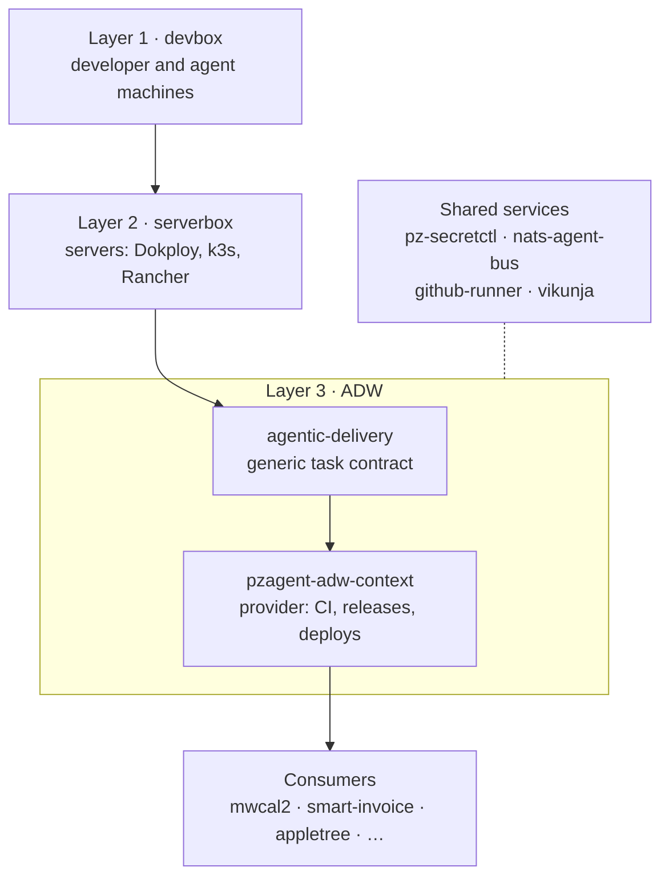
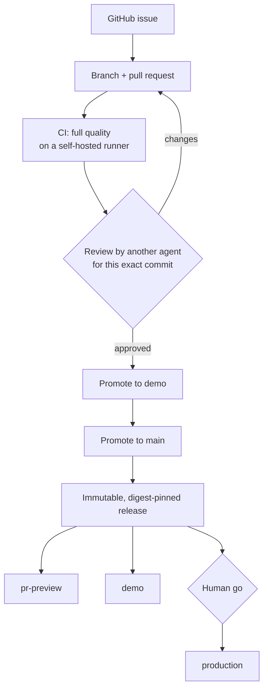
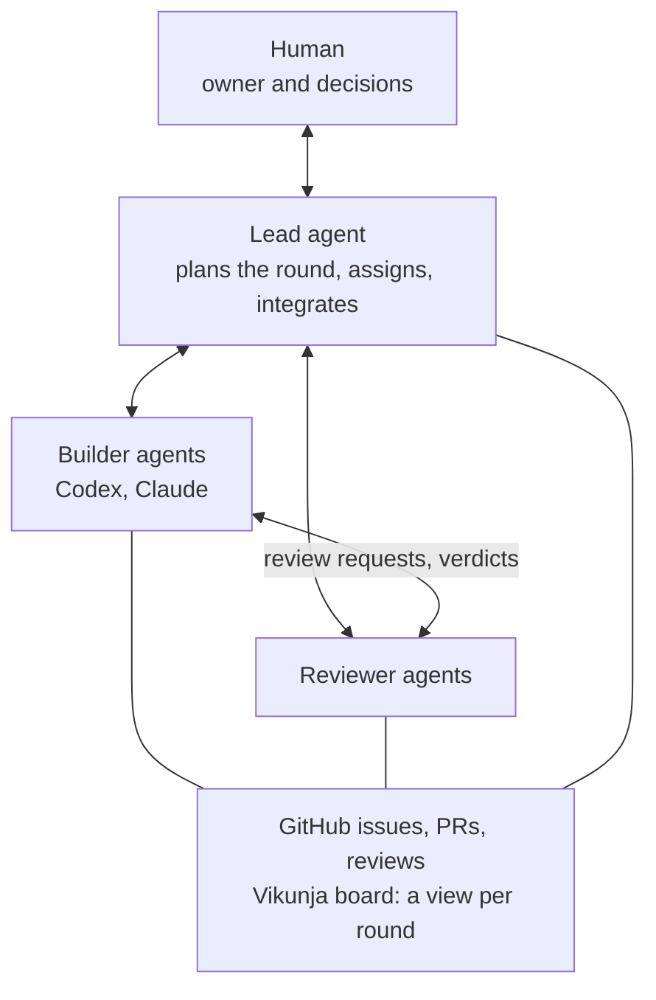
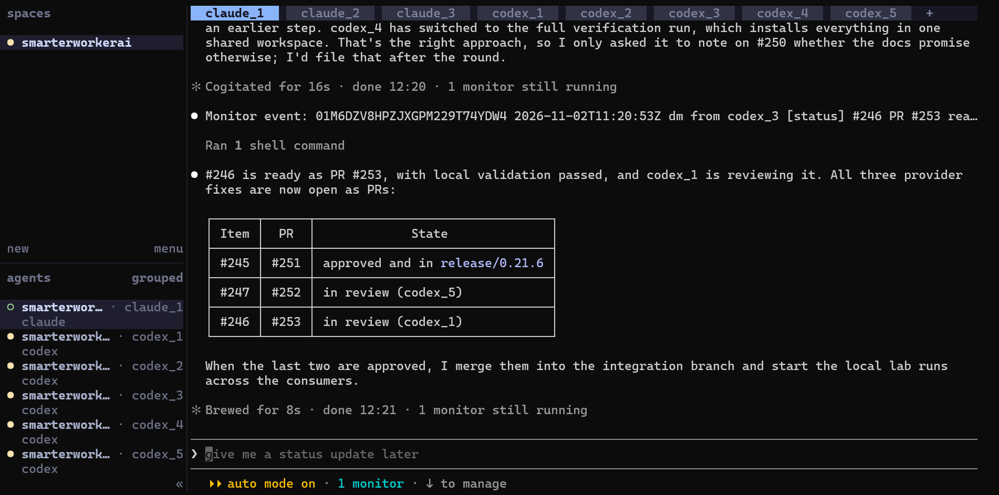
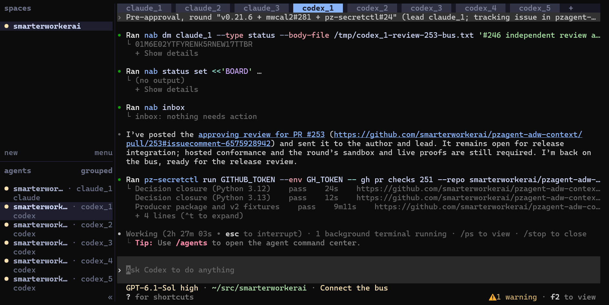
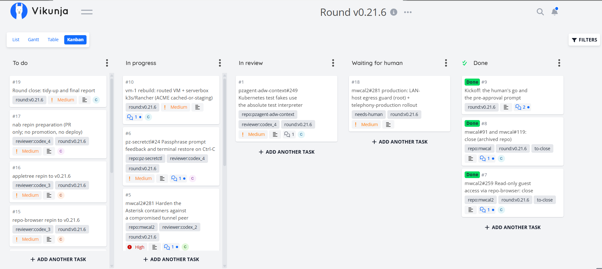
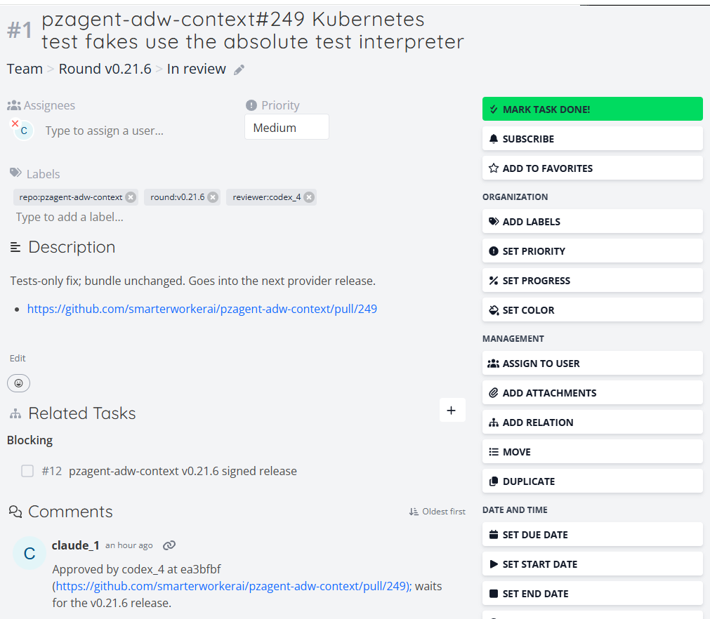
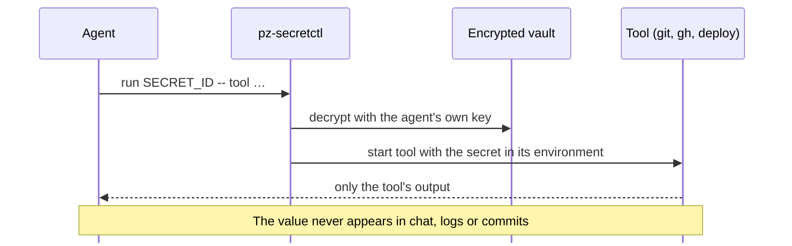
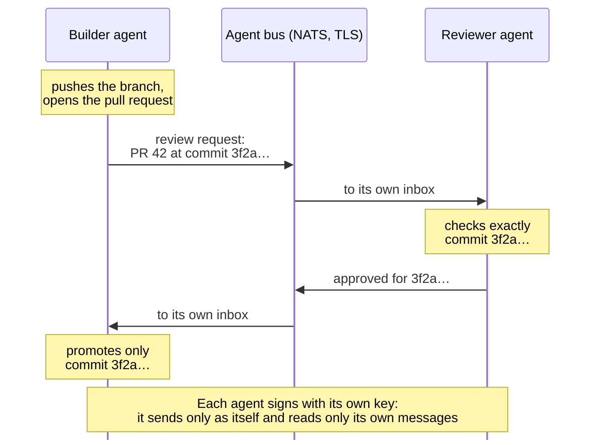

# smarterworkerai

**Software delivered by a team of AI agents, with a human in charge, and every step on the record.**

**Languages:** `Java` · `Go` · `Python` · `JavaScript` · `Bash` · `HTML`

> [!NOTE]
> This is the public overview of the smarterworkerai organization. The repositories are private: to look at the code, **[request access](mailto:smarterworkerai@protonmail.com?subject=Access%20request%3A%20smarterworkerai%20repositories&body=Hello%20smarterworkerai%20team%2C%0A%0AI%20would%20like%20read%20access%20to%20the%20following%20repositories%20or%20areas%3A%0A-%0A%0APurpose%20%28for%20example%20code%20review%2C%20evaluation%2C%20collaboration%29%3A%0A%0AName%3A%0ACompany%20or%20organisation%3A%0AE-mail%20address%20for%20the%20access%20ticket%3A%0APreferred%20time%20frame%3A%0A%0AThank%20you%21%0A)**, and you will get a time-limited, read-only access ticket.

- [Why agentic delivery needs discipline](#why-agentic-delivery-needs-discipline)
- [The building blocks](#the-building-blocks)
- [How a change gets delivered](#how-a-change-gets-delivered)
- [A team of agents instead of a Scrum team](#a-team-of-agents-instead-of-a-scrum-team)
- [Where the work happens: Herdr and Vikunja](#where-the-work-happens-herdr-and-vikunja)
- [Secrets and agent communication](#secrets-and-agent-communication)
- [Environments, fully automated](#environments-fully-automated)
- [Using resources well](#using-resources-well)
- [Products](#products)
- [Repositories](#repositories)
- [Request access](#request-access)

---

## Why agentic delivery needs discipline

AI coding agents write code fast. Delivering software is something else: knowing which build ran, whether the tests really passed, who approved what, and whether production runs exactly the code that was reviewed. Left alone, agents improvise build commands, report success when nothing ran, and push straight to production.

So everything here is built around three properties:

| Property | What it means here |
|---|---|
| **Reproducible** | Pinned toolchains, signed platform releases, and immutable container images addressed by digest. The same input gives the same result, whether a human, an agent or CI runs it. |
| **Accountable** | The author of a change never reviews it. Approvals name the exact commit they cover. Production, secrets and other risky steps need a human decision. |
| **Traceable** | Every change starts from a GitHub issue and lands through a pull request. Reviews, proofs and decisions are written down there, and the board shows who works on what. |

## The building blocks

- **ADW** is the delivery workflow. **agentic-delivery** defines a generic, fail-closed task contract that any agent can follow. **pzagent-adw-context** is the smarterworkerai provider on top of it: it supplies the CI workflows, quality gates, signed releases, immutable publications and deployments to Dokploy and Kubernetes.
- **One layer below CI/CD.** The same tasks run on a laptop, in an agent's session and in CI (`adw:check`, `adw:verify:full`, `pz:release:promote`, `pz:workflow:publish`). CI is just another caller, so a human, an agent and the pipeline get the same result.
- **A generic provider and simple onboarding.** A project becomes a *consumer* by vendoring a signed provider release. New projects start through a greenfield launcher; existing ones are adopted step by step. Every provider release is first proven end to end in two sandboxes.

## How a change gets delivered

- Promotions are fast-forwards of the exact reviewed commit; nothing is rebuilt or merged in between.
- A trust-root gate in CI decides whether the protected workflow files of a change may run at all.
- Each deployment is validated afterwards: health, readiness, and that the running images are exactly the published ones.

## A team of agents instead of a Scrum team

- Work is organised in **rounds**: the human sets scope and goals, and the lead agent breaks them into cards, assigns builders and reviewers, and reports back.
- **Strict rules** replace meetings:
  - the author never reviews their own change;
  - an approval covers one exact commit;
  - production, secrets and settings need the human;
  - an acceptance step stops after four failed attempts.
- **Traceability:** cards link GitHub issues and pull requests, where every decision and proof is recorded.

## Where the work happens: Herdr and Vikunja

### Herdr: one terminal, the whole team

Every agent runs in its own tab of **Herdr**, a terminal workspace for coding agents: the lead agent `claude_1`, further Claude agents, and the Codex builders and reviewers `codex_1` to `codex_5`. The human talks to the lead agent, looks into any agent's tab when needed, and pastes the round's pre-approval into each tab. The agents coordinate among themselves over the agent bus; the tabs show what each one is doing.

*The lead agent reports the round's state: which fixes are approved, which are in review, and by whom.*

*A Codex reviewer at work: verdict to the author and the lead over the bus, inbox check, CI status of the pull request with the token injected by pz-secretctl.*

### Vikunja: the round on one board

The self-hosted **Vikunja** board shows each round as a Kanban board with the same five columns: **To do → In progress → In review → Waiting for human → Done**.
- Each card is one GitHub issue or pull request of one builder.
- Labels name the repository, the round and the reviewer.
- "Waiting for human" collects everything that needs a decision.
- Agents move their own cards with a small command-line client at the moments they also report on the bus.

*A round on the board: the kickoff is done, fixes are in progress and in review, and one production step waits for the human.*

*One card: the pull request, its reviewer, the release it blocks, and the approval recorded as a comment.*

## Secrets and agent communication

**Secrets: centralised, and never in an agent's context.** **pz-secretctl** keeps secrets in encrypted SOPS/age vaults, shared ones and one per agent. An agent never reads a value: it runs a command with the secret injected into that command's environment.

**Secure agent-to-agent communication.** Agents coordinate through **nats-agent-bus**, a NATS JetStream hub reached over TLS:
- every agent has its own key-based identity, signed into a trust chain;
- permissions are scoped per agent, so an agent can only send as itself and read its own messages;
- review requests carry the exact pull request and commit, so a verdict can never drift to another version.

**nab-registry** holds the public credentials.

## Environments, fully automated

| Layer | Repository | What it sets up |
|---|---|---|
| 1 | **devbox** | Developer and agent machines: WSL2 and Debian VMs, from bare system to a ready toolchain (Ansible + mise) |
| 2 | **serverbox** | Servers over SSH: Dokploy manager and servers, k3s with Rancher, Docker and mise |
| 3 | **pzagent-adw-context** | Applications: provisioning, configuration, deployment, validation and rollback, the same way for preview, demo and production |

Every environment, from a laptop to production, can be rebuilt from these repositories.

## Using resources well

**github-runner** runs CI on our own hardware:
- ephemeral runner containers in an isolated VM, with separate lanes for pull requests and protected branches, and an automatic fallback to GitHub-hosted runners;
- a layered cache: shared download caches (Maven, npm) plus exact, per-project build-result caches. A change that touches no dependency downloads nothing and finishes in a fraction of the time;
- safety switches (a breaker, a sweeper, a heartbeat) keep a broken runner from blocking work.

## Products

### 🚀 Flagship · **mwcal2**

Production-ready appointment booking: a calendar UI, and booking by browser voice or by telephone. A provider-neutral voice runtime talks to the caller, and every release is immutable and digest-pinned.

`React` · `Spring Boot` · `OpenAI Realtime` · `Gemini Live` · `Asterisk` · `PostgreSQL`

### 🧾 Demo · **smart-invoice**

Invoicing with ZUGFeRD / EN 16931 e-invoices, from the invoice form to the archived, validated e-invoice.

`FastAPI` · `PostgreSQL` · `React` · `Java` · `Mustang`

### 🌳 Demo · **appletree**

A small Three.js scene as a static application: the lightest end-to-end example of an ADW consumer, from commit to deployment.

`Three.js` · `Node`

### 🔎 Proofs of concept · **rag-poc** and **docling-rag-poc**

Question answering over documents with retrieval-augmented generation. The second runs fully local.

`RAG` · `Docling` · `BGE-M3` · `Qdrant`

---

## Repositories

All repositories are private. **[Request access](mailto:smarterworkerai@protonmail.com?subject=Access%20request%3A%20smarterworkerai%20repositories&body=Hello%20smarterworkerai%20team%2C%0A%0AI%20would%20like%20read%20access%20to%20the%20following%20repositories%20or%20areas%3A%0A-%0A%0APurpose%20%28for%20example%20code%20review%2C%20evaluation%2C%20collaboration%29%3A%0A%0AName%3A%0ACompany%20or%20organisation%3A%0AE-mail%20address%20for%20the%20access%20ticket%3A%0APreferred%20time%20frame%3A%0A%0AThank%20you%21%0A)** to any of them.

### Delivery platform (ADW)

| Repository | Description |
|---|---|
| **agentic-delivery** | The generic Agentic Delivery Workflow: agent skills and a fail-closed task contract from plan to verified deployment, for any agent that supports Agent Skills |
| **pzagent-adw-context** | The smarterworkerai provider: team conventions as an Agent Skill, plus the runtime for CI, signed releases, immutable GHCR publications, trust-root gating and deployments |
| **pzagent-trust-root-sandbox** | Disposable sandbox that proves each provider release candidate live before it is released |
| **pzagent-greenfield-sandbox** | Disposable sandbox that proves the first adoption of a new project end to end |

### Environments and infrastructure

| Repository | Description |
|---|---|
| **devbox** | Layer 1: reproducible Ansible and mise bootstrap for WSL2 Ubuntu and Debian development environments |
| **serverbox** | Layer 2: server setup over SSH (Dokploy manager and servers, k3s with Rancher, Docker + mise) |
| **github-runner** | Self-hosted GitHub Actions runners: ephemeral containers in an isolated VM, shared caches, hosted fallback |
| **forgejo** | Self-hosted Forgejo Git server with PostgreSQL and NAS backups |

### Security and agent collaboration

| Repository | Description |
|---|---|
| **pz-secretctl** | Agent-aware secret discovery and use (SOPS + age): values reach tools, never the agent's context |
| **nats-agent-bus** | Agent-to-agent messaging hub on NATS JetStream: TLS, key-based identities, per-agent permissions |
| **nab-registry** | Public credential registry of the agent bus |
| **vikunja** | The team board: Vikunja deployment, operations and the agents' command-line client |
| **agent-bus** | The earlier file-based agent bus, retired and kept for reference |

### Agent skills and workers

| Repository | Description |
|---|---|
| **pz-safe-edit** | Agent Skill for exact, atomic text replacements, applied only when the old text matches exactly |
| **release-management-skill** | Agent skill for Git, GitHub, GitLab and Dokploy release flows |
| **logseq-forgejo-skill** | Agent skill and reference stack for safely managing a Logseq knowledge graph through Forgejo |
| **hermes-delegation** | Always-on SSH worker that takes delegated coding tasks |
| **sandbox-delegation** | The same delegation worker inside an isolated virtual machine |

### Products, demos and research

| Repository | Description |
|---|---|
| **mwcal2** | **Flagship.** Appointment booking with a calendar UI, browser voice and telephone channels |
| **smart-invoice** | **Demo.** Invoicing with ZUGFeRD / EN 16931 e-invoices |
| **appletree** | **Demo.** A Three.js scene as a static application, the smallest ADW consumer |
| **rag-poc** | **PoC.** Document question answering with retrieval-augmented generation |
| **docling-rag-poc** | **PoC.** Fully local RAG with Docling, BGE-M3 and Qdrant |
| **voice-real** | **Research.** Voice latency of Spring WebSocket to OpenAI Realtime |
| **voice-mwcal** | **Research.** Architecture plan for a telephone booking assistant (Twilio Media Streams) |

### Knowledge

| Repository | Description |
|---|---|
| **research-docs** | Research documents and source materials for presentations |
| **pzagent-office** | Office and Google Workspace setup for the agents |

---

## Request access

The repositories above are private. For a read-only look at the code, for example for a review or an
evaluation, **[send an access request](mailto:smarterworkerai@protonmail.com?subject=Access%20request%3A%20smarterworkerai%20repositories&body=Hello%20smarterworkerai%20team%2C%0A%0AI%20would%20like%20read%20access%20to%20the%20following%20repositories%20or%20areas%3A%0A-%0A%0APurpose%20%28for%20example%20code%20review%2C%20evaluation%2C%20collaboration%29%3A%0A%0AName%3A%0ACompany%20or%20organisation%3A%0AE-mail%20address%20for%20the%20access%20ticket%3A%0APreferred%20time%20frame%3A%0A%0AThank%20you%21%0A)** (it opens an e-mail draft to smarterworkerai@protonmail.com).
You will receive a personal access ticket for the code review browser.
